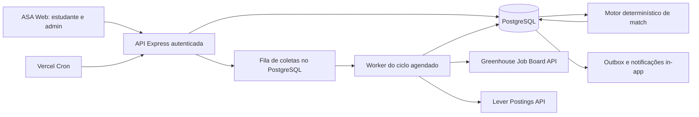

# Arquitetura ASA Match

O frontend usa React Query contra a API existente. A API usa a sessão autenticada e associa dados ao `student_id` obtido no backend; o cliente não escolhe o proprietário. Operações administrativas exigem a permissão existente `settings:manage`.

O coletor chama apenas hosts e endpoints codificados para os conectores suportados, recebe um `boardSlug` validado e não aceita URL arbitrária. Redirecionamentos HTTP são recusados; timeout, tentativas limitadas e tamanho de payload são limitados. O cron chama `enqueueDueSources`, processa um lote pequeno e entrega alertas pendentes.

O score é uma ordenação de afinidade determinística (curso/área 25%, skills 25%, localização 20%, modalidade/disponibilidade 15%, interesses 15%). Dados faltantes não são incompatibilidade automática. `eligible` requer dados acadêmicos verificados; caso contrário a elegibilidade é `unverified`. O score não prevê contratação.

Deploy com worker persistente dedicado poderá substituir o processamento no cron sem mudar o modelo de domínio. A duração real do ciclo depende dos limites do runtime e quantidade de fontes; acompanhar tempo e falhas antes de aumentar o lote.
