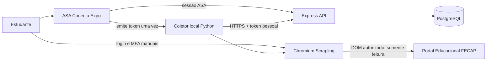

# Arquitetura

O backend Node continua a autoridade de autenticação e resolve o estudante pela sessão existente. O token de sync, aleatório e de alta entropia, é persistido como SHA-256, limitado à conexão de um estudante e revogável. O coletor guarda inventário local separado por sessão, chama apenas a API do ASA e não aceita `student_id` do cliente. Nenhum worker residente é necessário: a navegação longa corre no computador do usuário, não em função Vercel.
