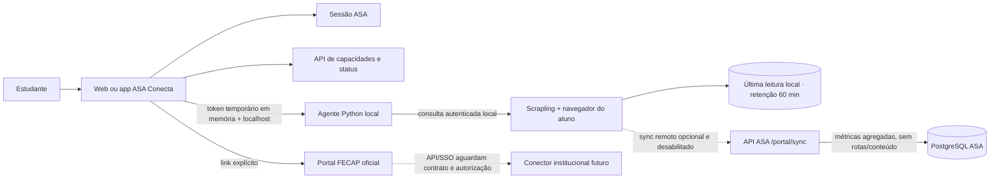

# Auditoria e status da integração do Portal FECAP

Atualizado em 2026-11-01. Esta auditoria descreve o repositório local; não representa autorização institucional nem validação em produção.

## Diagnóstico do repositório

| Camada | Implementação existente | Uso nesta integração |
|---|---|---|
| Web | React 19, TypeScript, Vite 8, React Router 7, TanStack Query, Radix UI | Rota autenticada `/aluno/portal-fecap` consulta capacidades remotas e, sob ação do aluno, consulta o agente local |
| Mobile | Expo 57, React Native 0.86, TypeScript | Tela de integração existente com abertura do Portal oficial e distinção entre token do coletor e sessão institucional |
| API/BFF | Express 5, TypeScript, PostgreSQL | Rotas versionadas em `/api/v1/portal`; autorização de estudante e resolução do titular no servidor |
| Persistência | PostgreSQL e migrations SQL numeradas | Conexão do coletor, execuções, mapa reduzido e trilha de auditoria |
| Coletor experimental | Python, Scrapling, Playwright | Processo local em `127.0.0.1`, navegação somente leitura e resultados exibidos localmente; sujeito a autorização institucional |
| Identidade ASA | Sessões próprias do ASA Conecta; cookies HttpOnly no web e token de sessão no app | Não é identidade federada FECAP e não autentica automaticamente o Portal Educacional |

O projeto contém páginas ASA para vida acadêmica e documentos e rotas de dados acadêmicos próprias. Elas não constituem prova de consulta direta ao Portal Educacional. O conector local cria um token ASA para sincronizar um inventário; esse token não é credencial FECAP, SSO ou autorização da instituição.

## Fontes oficiais consultadas

- O [Portal do Aluno](https://portal.fecap.br/) é o destino oficial de autenticação.
- A [instrução oficial de acesso](https://www.fecap.br/asa/cesta-de-servicos/acesso-ao-portal-do-aluno/) informa que o Portal reúne documentos, notas, faltas, boletos, vagas, horários e requerimentos, e instrui o uso do Registro de Aluno. A mesma página indica o ASA como canal de ajuda.
- A página [EduFECAP](https://www.fecap.br/edufecap/home/) foi consultada como referência institucional, sem evidência pública de contrato de API/SSO para esta aplicação.

As páginas públicas consultadas não documentam para este projeto um provedor OAuth/OIDC/SAML, API de dados acadêmicos, escopos de consulta ou autorização para automação de uma sessão autenticada. A interface pública do portal tampouco permite confirmar contratos internos. Portanto, esses recursos são tratados como **não confirmados**, não como inexistentes em toda a infraestrutura da FECAP.

## Matriz de integração

| Capacidade | Origem pretendida | Estado no código | Evidência/pendência |
|---|---|---|---|
| Acesso ao portal oficial | `https://portal.fecap.br/` | Disponível como link externo; login ocorre no domínio FECAP | Referência oficial pública |
| Login institucional dentro do ASA | FECAP IdP | Não configurado | Necessita aprovação e metadados/contrato do provedor institucional |
| API oficial de perfil acadêmico | Portal/TOTVS | Não confirmada | Necessita documentação, credenciais de serviço e escopos autorizados |
| Disciplinas, notas e frequência | Fonte acadêmica institucional | Não integrada pelo Portal FECAP | Telas ASA existentes não são uma integração do Portal |
| Horários e histórico | Fonte acadêmica institucional | Não integrada | Necessita endpoint/serviço autorizado e contrato de dados |
| Documentos | Repositório/Portal FECAP | Não integrado | A tela ASA atual acompanha arquivos enviados em chamados ASA, não documentos lidos do Portal FECAP |
| Requerimentos | Portal FECAP | Não integrado | Chamados ASA são distintos de requerimentos institucionais |
| Estágios / DocuSign | Sistemas institucionais | Não integrados à sessão FECAP | Necessita escopos e acesso oficial; não foi testada conta DocuSign |
| Financeiro | Portal FECAP | Não integrado | Não são consultados boletos ou pagamentos pela camada ASA |
| Coletor local read-only | Navegador do próprio usuário | Experimental, separado de SSO/API; requer autorização para uso conectado | Nenhum mapeamento real foi considerado validado nesta implementação |

## Arquitetura atual e fronteiras

Não existe sessão FECAP gerenciada pelo ASA Conecta. Logout ASA não encerra a sessão do domínio FECAP. Um futuro conector deverá usar SSO/API oficial ou permanecer como link externo assistido pelo estudante.

## Implementação desta revisão

- Endpoint autenticado `GET /api/v1/portal/capabilities` declara SSO e API como não configurados/não confirmados, módulos acadêmicos como não integrados e o coletor local como experimental.
- Página web `/aluno/portal-fecap` mostra esses estados, abre o domínio oficial e pode iniciar/consultar o agente local após token de exposição única mantido apenas em memória.
- Tela mobile também direciona para o domínio oficial e diferencia o token do coletor de uma conexão institucional.
- O coletor local entrega texto e tabelas extraídos apenas ao navegador local do aluno. Essa leitura não passa pela API remota do ASA.
- Por padrão, os dados locais ficam fora do repositório, expiram após 60 minutos e apenas a execução mais recente é mantida.
- O cliente do coletor não envia páginas, rotas, títulos, URLs, tabelas ou documentos à API remota; quando a sincronização opcional é ligada, envia apenas métricas e ID derivado. A API também sanitiza payloads recebidos e a migration 016 reduz inventários legados.
- A migration `016_fecap_portal_data_minimization.sql` reduz registros anteriores para os mesmos metadados mínimos.
- O coletor local ignora `FECAP_PASSWORD`; a senha é solicitada no terminal com entrada oculta.

## Próximas dependências institucionais

1. Aprovação escrita para o ASA Conecta como cliente da integração.
2. Documentação técnica oficial do IdP/API e ambientes de teste.
3. Escopos de menor privilégio por módulo, limites, expiração e revogação.
4. Validação de finalidade, papéis de tratamento, base legal, retenção e compartilhamento conforme LGPD.
5. Conta institucional de homologação aprovada; não usar contas reais em testes automatizados.
6. Revisão de segurança e homologação antes de qualquer integração/implantação real.

Nenhuma senha institucional deve ser solicitada em chat, prompt, issue ou arquivo. O coletor experimental não deve ser habilitado para produção sem autorização expressa e revisão de privacidade.

## Verificações desta revisão

- API: typecheck, build e lint aprovados; 350 testes unitários aprovados, incluindo o contrato de capacidades e a verificação de que o conteúdo coletado não é persistido.
- Web: typecheck, build e lint aprovados; 275 testes aprovados; E2E público ASA: 5 cenários aprovados (inclui viewport mobile e navegação).
- Mobile: typecheck e lint sem erros; 567 testes aprovados. O lint ainda reporta 10 avisos preexistentes de estilo de tipos em `types/api.ts`.
- Coletor Python: Ruff aprovado e 15 testes aprovados, incluindo autenticação local, filtros, CORS, leitura de dados e garantia de que `FECAP_PASSWORD` não é lido do ambiente.
- A migration 016 foi adicionada ao manifesto, mas não foi aplicada a um banco neste ambiente.
- Não houve autenticação no Portal FECAP, uso de credenciais reais, consulta de notas/documentos reais ou teste de API/SSO institucional.
