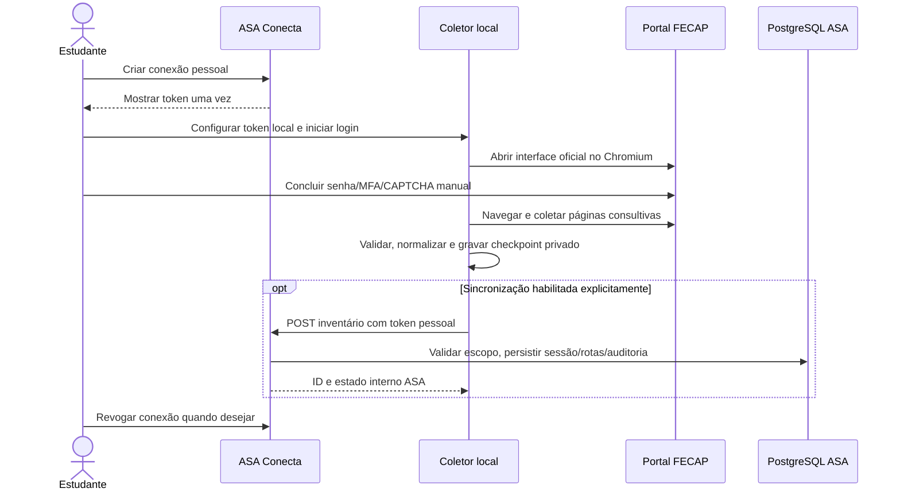

# Fluxo operacional

Em falha, a sessão local permanece em checkpoint incompleto; o comando `scan --resume` tenta retomar rotas ainda não visitadas após reautenticação. A sincronização deve ser repetida manualmente; não há agenda automática nesta versão.
