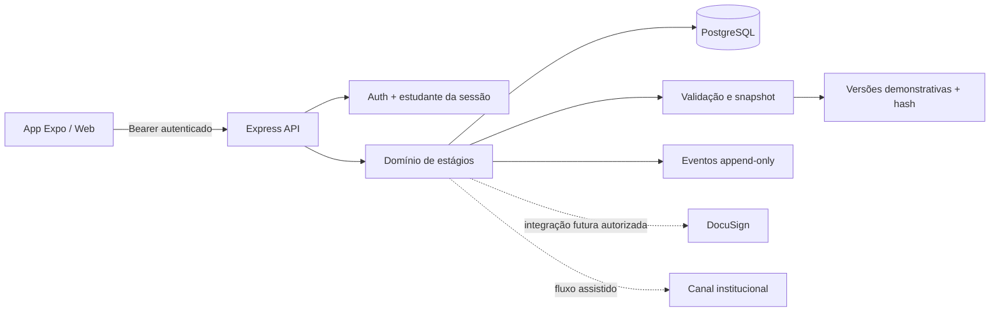

# Arquitetura

O módulo reaproveita autenticação e PostgreSQL da Entrega 2; não cria serviço separado nem duplicação de usuários. As rotas são montadas na API quando a runtime entrega o pool. Web e mobile usam o mesmo aplicativo Expo com React Native Web.
