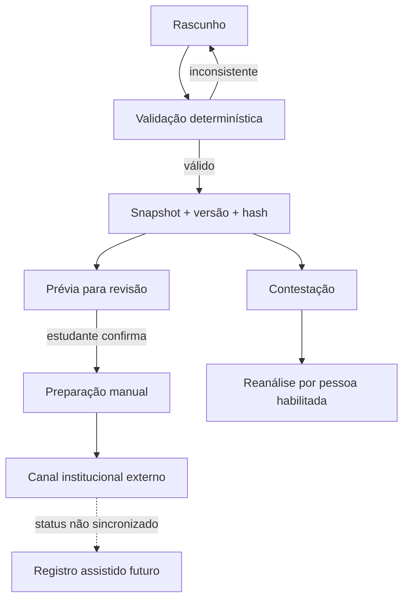

# Fluxos

Preparar encaminhamento não envia, assina nem cria aprovação. Uma rejeição só pode ser registrada futuramente por ator autorizado, sem reversão automática.

As orientações públicas consultadas da FECAP direcionam o envio pelo Portal do Aluno (FECAP+ Oportunidades → Gestão de Estágio ou Secretaria/Requerimentos → Estágio: Entrega de Documentação), indicam a FECAP como última signatária e listam condições acadêmicas para aprovação. O app não valida essas condições nem sincroniza o portal; confirme o procedimento vigente na [orientação institucional de entrega](https://www.fecap.br/asa/cesta-de-servicos/entrega-de-documentos-de-estagio/). Os [modelos publicados pela FECAP](https://www.fecap.br/asa/cesta-de-servicos/modelos-de-documentos-de-estagio/) incluem Termo de Compromisso/Plano de Atividades, Acordo de Cooperação, Relatório Semestral, Termo Aditivo, Rescisão e Plano de Trabalho; esta implementação não os reproduz como modelos oficiais.
