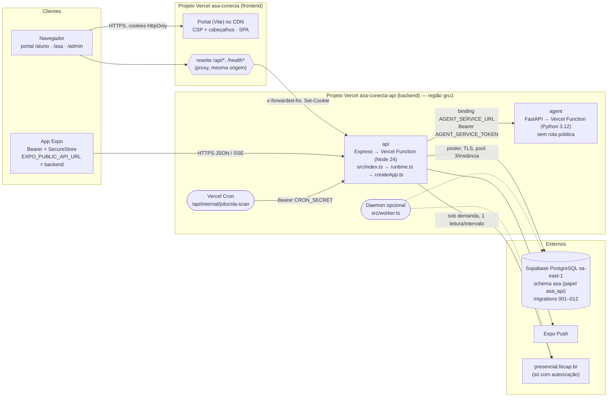

# 09 — Arquitetura final

## Componentes

| Componente | Onde roda | Responsabilidade | Estado |
|---|---|---|---|
| Portal web | CDN da Vercel (projeto `asa-conecta`) | interface de aluno, equipe ASA e administração | sem estado; sessão em cookie HttpOnly |
| App mobile | aparelho (Expo) | interface do aluno, voz e "Hey ASA" no aparelho | refresh token no SecureStore (só com "Manter conectado") |
| API | Vercel Function (projeto `asa-conecta-api`, serviço `api`) | autenticação, permissões, regras de negócio, assistente, fila, push, auditoria | **sem estado entre requisições**: tudo no PostgreSQL |
| Agent Service | Vercel Function privada (projeto `asa-conecta-api`, serviço `agent`) | motor de regras explicáveis (recomendações com evidências e abstenção) | sem estado |
| Worker (opcional) | Vercel Daemon / qualquer processo | leitura contínua da fila e varredura de prazos | coordenado pela concessão no banco |
| PostgreSQL | Supabase, schema `asa` | dados, anexos (`bytea`), estado da fila, concessões, auditoria | durável, com backup |

## Uma composição, três formas de execução

`src/runtime.ts` monta tudo (configuração, logger, pool, repositórios, notificações, fila e app). Muda só quem
dirige os laços:

| Entrada | Comando | Fila | Prazos (SLA) | Uso |
|---|---|---|---|---|
| `src/index.ts` | (Vercel) / `npm run start:vercel-entry` | sob demanda (`refresh`) | `/api/internal/jobs/sla-scan` | produção na Vercel |
| `src/server.ts` | `npm start` / `npm run dev` / Docker | laço residente | `setInterval` | desenvolvimento, Docker, servidor próprio |
| `src/worker.ts` | `npm run worker` / Vercel Daemon | laço residente | `setInterval` | push com o app fechado |

As três usam a mesma concessão (`job_leases`) e podem rodar juntas sobre o mesmo banco: só uma consulta a fonte da
fila por vez.

## Fluxos principais

1. **Login (app).** `POST /api/auth/login` → bcrypt → access token (15 min, em memória) + refresh token (no
   SecureStore com "Manter conectado"). Renovação única compartilhada. Logout revoga a família de tokens.
2. **Login (portal).** `POST /api/web/auth/login` no domínio do portal → rewrite → backend → cookies
   HttpOnly/Secure gravados no domínio do portal. Toda escrita confere a origem (CSRF) contra `WEB_ORIGINS`, que
   contém o domínio do portal.
3. **Dados acadêmicos.** `GET /api/student/*` → o aluno vem do token (nunca de um `studentId` do cliente) →
   PostgreSQL.
4. **Análise do agente.** `POST /api/agent/analyze` → a API monta o contexto autorizado → binding → Agent Service →
   resposta validada contra o contrato → gravada (`agent_runs`, recomendações e evidências) → exibida com
   justificativa. Nenhuma decisão administrativa é automática.
5. **Assistente (voz/texto).** O aparelho transcreve → `POST /api/assistant/message` (texto) → intenção → consulta
   autorizada ou base de conhecimento com fontes → resposta. A síntese de voz acontece no aparelho.
6. **Fila presencial.** Leitura → concessão → fonte (no máximo uma vez por intervalo) → estado no banco →
   acompanhamentos → alertas/push → SSE (240 s, com reconexão).
7. **Tarefas agendadas.** Vercel Cron ou agendador externo → `/api/internal/jobs/*` com `CRON_SECRET`.

## Observabilidade

- Logs JSON (pino) com `request_id`, `correlation_id` (propagado ao agente), `env`, `runtime`, `region`, método,
  rota, status e duração. Senhas, tokens e cookies são redigidos.
- `GET /health`: banco e agente (503 se algum estiver fora). `GET /health/queue`: monitor da fila. Admin → Saúde:
  latências, migrations pendentes, integrações.
- Na Vercel: Runtime Logs, Observability e `vercel logs`.
