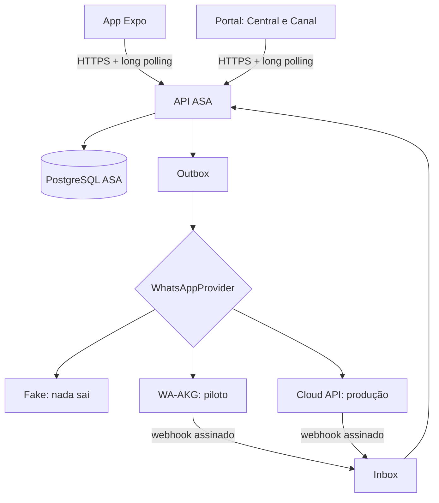

# Arquitetura



**Regra central:** o chamado é o mesmo registro em todos os canais. O WhatsApp é um transporte. Clientes nunca falam com o provedor.

## Decisões

### Long polling em vez de Socket.IO

A produção roda em funções serverless, sem conexão persistente. `GET /api/support/{staff|me}/events?since=&wait=` segura a chamada até 25 s e serve também como reconciliação (`wait=0`).

Vantagens: funciona no app sem dependência nova, e cada chamada reautentica, então revogar sessão ou papel corta o acesso na chamada seguinte, sem gerenciar sockets. Custo: uma consulta por cliente a cada 1,5 s durante a espera, aceitável nesta escala. Latência típica até 1,5 s. O texto da interface diz "Atualizando ao vivo", e mostra quando está sem conexão.

### Cursor pela ordem de commit

`bigserial` sozinho perde eventos: uma transação lenta pode gravar o id 10 depois que um leitor já passou do 11. O log guarda `tx_id = pg_current_xact_id()`, e a leitura só avança até `pg_snapshot_xmin(pg_current_snapshot())`, o limite abaixo do qual nenhuma transação pode mais gravar. Há teste específico com transação aberta.

Efeito colateral: uma transação longa no banco atrasa o feed até terminar, inclusive de outro schema, porque os ids são do cluster. O feed atrasa, não perde.

`sequence` é monotônica por chamado, mas não define a ordem do feed: duas transações muito próximas no mesmo chamado podem chegar invertidas. Clientes recarregam o chamado a cada evento e não ordenam por ela.

### Outbox transacional

A resposta da equipe grava mensagem, evento e outbox na mesma transação e responde **202**. O envio ocorre depois, e o estado real chega por evento.

```text
queued → sending → sent → delivered → read
   ↓        ↓
retry    unknown (ambíguo: nunca reenvia sozinho)
   ↓
failed
```

- **Pode repetir:** o que comprovadamente não saiu (recusa de conexão, 429, 503, sessão desconectada), com espera crescente, até 5 tentativas.
- **Nunca repete sozinho:** timeout, queda no meio da conexão, 5xx genérico, exceção ao chamar o provedor ou envio interrompido por queda do processo. Vira `unknown`, e a equipe decide, avisada de que pode duplicar.
- **Reserva item a item:** a trava de 120 s cobre um envio, não a fila inteira, e é maior que o tempo limite do provedor.
- **Confirmação não regride:** depois de `sent`, `delivered` ou `read`, só o provedor muda o estado.
- **Disjuntor:** 5 falhas seguidas suspendem envios por 60 s e marcam o canal como instável.

### Vínculo pelo caminho inverso

Em vez de OTP enviado ao número, o estudante autenticado recebe um código e o envia **do próprio WhatsApp** para o número institucional:

- nenhum número é digitado, então não há como testar se o número de alguém tem cadastro;
- nenhuma mensagem sai sem pedido;
- funciona quando o WhatsApp só informa um identificador opaco (LID).

Depois da prova, o estudante reconhece o número mascarado e confirma. Chamados anteriores só vêm com autorização explícita. Número já ligado a outra conta vira revisão humana, com a mesma resposta genérica. A equipe não vincula manualmente: o caminho é pedir ao estudante que faça isso pelo app.

### O número não é a pessoa

Um número pode mudar de dono: revogar o vínculo e outra conta verificar o mesmo número. A identidade de quem escreve vem do **dono do chamado**, não da conversa, e o vínculo revogado solta os chamados do estudante daquela conversa, na mesma transação. Assim:

- o chamado continua do estudante, e o número não escreve mais nele, nem o reabre;
- nenhuma resposta sobre esse chamado sai para aquele número, nem as que já estavam na fila;
- quem vincula sem autorizar chamados anteriores continua "contato" no chamado em aberto, sem nome de estudante.

### Só responde, nunca inicia

O MVP não tem nenhuma rota para iniciar conversa, disparo em massa, grupos ou status. Fora de escopo por política, e ausente por construção.

## Modelo de dados (migration 017)

| Tabela | Papel |
|---|---|
| `support_channels`, `support_provider_connections` | Canal e estado confirmado pelo provedor. Credenciais só em variáveis de ambiente |
| `support_conversations` | Contato por canal, opcionalmente ligado a estudante. Telefone: impressão digital + cifra + máscara |
| `support_contact_links`, `support_consent_records`, `support_contact_verifications` | Vínculo verificado e consentimento |
| `support_inbox_dedup` | Deduplicação de webhooks; conteúdo cifrado só até o processamento |
| `support_outbox` | Envio reprocessável |
| `support_event_log` | Tempo real, só-inserção, sem conteúdo nem telefone |
| `support_tags`, `support_ticket_tags`, `support_saved_replies`, `support_ticket_presence` | Operação |

Alterações em tabelas existentes: `support_tickets` (`student_id` nulo, `conversation_id`, `last_sequence`), `support_ticket_messages` (transporte, entrega, visibilidade), `support_attachments` (origem, visibilidade, análise).

Unicidades que sustentam a idempotência:

- `(provider, channel_id, provider_event_id)` na inbox;
- `(channel_id, external_message_id)` nas mensagens;
- `(ticket_id, client_message_id)` nas respostas;
- um chamado aberto por conversa;
- um vínculo ativo por contato.

## Situação do chamado

Equivalência com o prompt: NEW = `received`; TRIAGE = `triage`; OPEN = `assigned`, `in_analysis`, `in_progress`; WAITING_STUDENT = `waiting_student`; WAITING_INTERNAL = `waiting_department`, `waiting_external`. Tabela em `STAFF_TRANSITIONS` (`support/statuses.ts`).

Estado de entrega é da mensagem. Nenhum webhook de entrega altera a situação do chamado.

A leitura de estado nunca religa um canal: `desired_connected` guarda a decisão da administração, e só um pedido de conexão a muda.

A primeira resposta conta respostas pelo WhatsApp mesmo quando ficam fora do histórico do aluno. Limitação: conta a partir de quando a resposta entra na fila, mesmo que o envio falhe depois.

Regra para mensagem recebida: chamado aberto → entra nele; resolvido há até 7 dias → reabre; caso contrário → chamado novo.

## Papéis

| Prompt | Papel existente |
|---|---|
| `STUDENT` | `student` |
| `ASA_STAFF`, `ASA_SUPERVISOR` | `institutional_staff` (não existe supervisor separado) |
| `ASA_ADMIN` | `technical_admin`, com `support_channels:manage`, **sem** acesso a conversas (ADR-008) |
| `SYSTEM_WORKER` | Webhooks por assinatura; tarefas por `CRON_SECRET` |

Limitação herdada: a equipe vê todos os chamados, sem restrição por setor. O prompt pede escopo por fila; isso exigiria definir equipes por usuário, o que o sistema ainda não tem.

## Serverless e laços

| Tarefa | Docker / `npm start` | Vercel |
|---|---|---|
| Enviar outbox | Laço de 5 s + disparo imediato | `waitUntil` depois da resposta + operador conectado + `/api/internal/jobs/support-outbox` |
| Reprocessar inbox | Laço de 5 s | Mesmo acima |
| Conferir estado do canal | Laço de 60 s | Ao abrir a tela (cache de 30 s) + `support-channel-health` |
| Reconciliar WA-AKG | A cada 5 min | `support-whatsapp-reconcile` |
| Retenção e limpeza | Sob agendamento | `support-maintenance` |

Os crons não foram adicionados ao `vercel.json`, porque o plano Hobby limita a uma execução diária. Use um agendador externo com `CRON_SECRET`.
