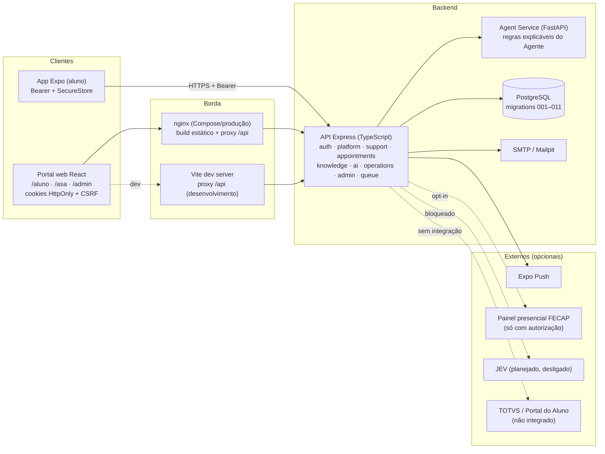
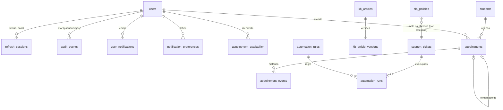

# Arquitetura da plataforma (app + portal web)

Uma API, um banco e dois clientes. O app Expo continua sendo o canal do aluno no celular. O portal web
atende três perfis: aluno, equipe ASA e administração. Tudo que é regra (permissões, prazos, reservas,
auditoria) mora **na API**. Os clientes só apresentam.

## 1. Visão de contêineres



- **Mesma origem no navegador**: o portal fala com `/api` no próprio domínio (nginx ou proxy do Vite). Por isso
  os cookies de sessão funcionam sem CORS aberto.
- **Sem fonte acadêmica institucional**: disciplinas, notas e frequência vêm do seed fictício (modo
  demonstração) ou respondem 503 (modo institucional sem integração). Ver
  [DEMO_DATA_POLICY.md](DEMO_DATA_POLICY.md).

## 2. Módulos da API

| Pasta (`api/src`) | Responsabilidade |
|---|---|
| `auth/` | Matriz de permissões, cookies e CSRF do portal, segredos derivados |
| `services/authService.ts` | Login, cadastro, refresh por família e canal, sessões, `/me` |
| `platform/` | Auditoria (só inserção, pseudônimos), parâmetros com cache, central de avisos, informações da plataforma e modo de dados |
| `support/` | Chamados: estudante, equipe, SLA, anexos, avisos, ganchos de SLA e automação |
| `appointments/` | Disponibilidade, horários livres, reserva sem conflito, remarcação atômica, `.ics` |
| `knowledge/` | Base de conhecimento versionada, busca full-text em português |
| `ai/` | Registro de provedores (`existing` ativo, `JevAdapter` desligado) |
| `assistant/` + `services/assistantService.ts` | Intenções, respostas, citações, abstenção e encaminhamento |
| `operations/` | Painel e métricas do ASA, CSV sem dados pessoais, contexto do aluno (auditado), indicadores do agente |
| `admin/` | Contas e convites, metas de SLA, automações (motor idempotente), integrações, saúde, parâmetros, metadados de chamados |
| `queue/`, `notifications/` | Fila presencial (monitor líder, SSE) e push Expo |

Cada módulo recebe as dependências por `createApp(deps)`. Os repositórios PostgreSQL têm versões em memória
para os testes unitários. Módulos que dependem de recursos do PostgreSQL (agendamentos, base de conhecimento,
métricas, administração) respondem `503 database_required` sem banco.

## 3. Sessão do portal (cookie + CSRF)

```mermaid
sequenceDiagram
  autonumber
  participant B as Navegador (portal)
  participant N as nginx / Vite (mesma origem)
  participant A as API
  participant D as PostgreSQL
  B->>N: POST /api/web/auth/session (sondagem na abertura)
  N->>A: repassa
  A-->>B: 200 {authenticated:false} + Set-Cookie asa_csrf
  B->>N: POST /api/web/auth/login (X-CSRF-Token = asa_csrf, Origin)
  N->>A: repassa
  A->>A: confere CSRF (duplo envio) + Origin ∈ WEB_ORIGINS
  A->>D: valida senha, cria sessão (família, canal web)
  A-->>B: Set-Cookie asa_at (HttpOnly, Path=/api), asa_rt (HttpOnly, Path=/api/web/auth)
  B->>N: PATCH /api/... (cookie asa_at + X-CSRF-Token)
  N->>A: repassa
  A->>D: sessão existe e não foi revogada?
  A-->>B: 200
  Note over B,A: acesso expirado → POST /api/web/auth/refresh (uma renovação por vez no cliente),<br/>refresh rotativo na mesma família; 403 csrf_failed → novo token CSRF e uma nova tentativa
```

## 4. Chamado entre canais

```mermaid
sequenceDiagram
  autonumber
  participant App as App (aluno)
  participant API as API
  participant DB as PostgreSQL
  participant Auto as Motor de automações
  participant Web as Portal /asa (equipe)
  App->>API: POST /api/support/tickets (Bearer, clientRequestId)
  API->>DB: prazo = meta de SLA vigente da categoria; chamado + eventos + aviso (1 transação)
  API->>Auto: onTicketCreated (regras ligadas; 1 execução por regra/chamado/gatilho)
  Auto->>DB: avisos internos para a equipe (nunca para o aluno)
  Web->>API: GET /api/support/staff/tickets (cookie)
  Web->>API: POST …/assign {team} (mesma equipe = assumir; outra = encaminhar)
  Web->>API: POST …/messages (versão esperada → 409 ticket_changed se outra pessoa alterou)
  API->>DB: mensagem + evento público + aviso ao aluno
  API-->>App: push (se configurado) / central de avisos
  App->>API: GET /api/support/tickets/:id → vê a resposta; equipe vê "lida"
```

- **Concorrência na fila**: toda alteração da equipe leva a versão do chamado. Se outra pessoa alterou antes, a
  API responde `409 ticket_changed` e o portal recarrega e explica.
- **Primeira resposta**: o prazo, em horas corridas pela meta da categoria (padrão 24 h), é gravado na abertura.
  A resposta é a primeira ação pública da equipe no histórico (mensagem, assumir, encaminhar ou resolver). A
  equipe vê a situação no chamado; o índice "no prazo" aparece em SLA e Métricas.
- **SLA**: o prazo é calculado na abertura em dias úteis, no fuso `America/Sao_Paulo`, a partir da meta
  vigente da categoria. Fica pausado enquanto o ASA espera o aluno e é estendido pelo tempo em pausa. A
  varredura periódica (`AUTOMATION_SCAN_INTERVAL_SECONDS`) aplica as regras de "prazo próximo" e "prazo
  excedido".

## 5. Agendamento sem reserva dupla

```mermaid
sequenceDiagram
  autonumber
  participant S1 as Aluno 1
  participant S2 as Aluno 2
  participant API as API
  participant DB as PostgreSQL (btree_gist)
  S1->>API: POST /api/appointments {startsAt, mode, location, clientRequestId}
  S2->>API: POST /api/appointments {mesmo horário e local}
  API->>DB: insert (exclusão: atendente × intervalo; aluno × intervalo)
  API->>DB: insert concorrente
  DB-->>API: 23P01 (exclusion_violation) para um deles
  API->>API: tenta o próximo atendente livre do mesmo horário/local
  API-->>S1: 201 AGD-2026-00042
  API-->>S2: 409 slot_unavailable (sem vaga)
```

- As restrições `appointments_no_attendant_overlap` e `appointments_no_student_overlap` são a garantia final, no
  banco. A API só escolhe o candidato de menor carga.
- Antes de inserir, a transação pega travas consultivas (`pg_advisory_xact_lock`) do atendente e depois do aluno,
  sempre nessa ordem. Reservas concorrentes para o mesmo atendente esperam a vez e recebem `23P01` limpo (vira
  `409`), sem impasse entre as restrições de exclusão. Se ainda assim houver impasse (`40P01`), a transação é
  repetida. Um teste de integração dispara cinco reservas simultâneas no mesmo horário: um `201`, quatro `409`,
  nenhum `500`.
- `clientRequestId` torna a reserva idempotente: repetir o pedido devolve o mesmo agendamento.
- Remarcar cancela o antigo e cria o novo **na mesma transação** (`rescheduledFromId` / `rescheduledToId`).

## 6. Modelo de dados novo (migrations 006–011)



| Migration | Conteúdo |
|---|---|
| 006 | `users.is_demo/last_login_at/invited_*`, sessões com família, canal e aparelho, canal `web` nos chamados, `audit_events` (só inserção), `platform_settings`, `user_notifications`, `notification_preferences` |
| 007 | `btree_gist`, disponibilidade, agendamentos com restrições de exclusão e protocolo `AGD-AAAA-NNNNN`, eventos só de inserção |
| 008 | Base de conhecimento versionada (`kb_articles`, `kb_article_versions` com `tsvector` em português e índice GIN) |
| 009 | `sla_policies`, `automation_rules`, `automation_runs` (único por regra × chamado × gatilho) |
| 010 | Índice parcial para o vínculo "remarcado para" |
| 011 | `support_tickets.first_response_due_at`: prazo da primeira resposta da equipe gravado na abertura |

Detalhes, aplicação e reversão: [DATABASE_MIGRATION_PLAN.md](DATABASE_MIGRATION_PLAN.md).

## 7. Sincronização entre canais

- **REST + invalidação de cache** (TanStack Query no portal) e **atualização periódica visível**: o portal mostra
  "Atualizado há …" com botão de atualizar (fila e painel a cada 30–60 s).
- **Tempo real (SSE)** só na fila presencial, que já existia. Não há WebSocket novo.
- **Avisos**: uma central única (`/api/notifications`) junta os avisos de chamados e os demais. Ler num canal
  marca como lido no outro. O push é complementar.

## 8. Observabilidade

- Logs estruturados (pino) com `request_id` e `correlation_id` em toda requisição. Senhas e tokens não são
  registrados.
- Saúde:
  - `GET /health` (pública, resumida);
  - `GET /health/queue`;
  - `GET /api/admin/health` (administração): banco com latência e migrations aplicadas/pendentes, Agent
    Service com versões, fila, e-mail, push, versão, ambiente e tempo no ar.
- Auditoria consultável pela administração (`/api/admin/audit-events`) e por cada pessoa (`/api/audit/mine`).
